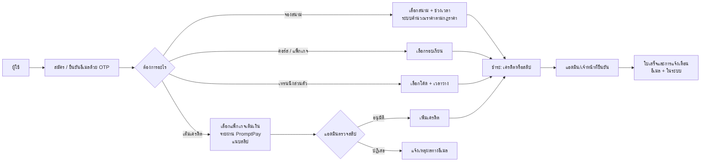

# Sports Court Booking & Management System (Case Study)

ระบบจองสนามบาสเกตบอลและจัดการสนามแบบครบวงจร ผู้ใช้ค้นหาและจองสนามตามช่วงเวลา สมัครคอร์สและแพ็กเกจ จองเทรนเนอร์ส่วนตัว เติมเครดิตแล้วนำไปใช้จ่าย ส่วนเจ้าหน้าที่และผู้ดูแลจัดการสนาม ราคา โปรโมชัน ตารางโค้ช การชำระเงิน และดูสรุปผลผ่านหน้าแอดมิน

**ลักษณะงาน:** โปรเจกต์ของทีมนักศึกษาฝึกงาน (ผู้ร่วมพัฒนา 8 คน) ก.ค. – ส.ค. พ.ศ. 2569 (2026) ประมาณ 6 สัปดาห์ ผมเป็น **พี่เลี้ยงและที่ปรึกษา** ให้คำแนะนำด้านการออกแบบและแนวคิด และดูแลการตั้งต้นและรวมงานของ repo โดย **โค้ดส่วนใหญ่เขียนโดยนักศึกษา** ไม่ใช่ผม
**ที่มาของโปรเจกต์:** ใช้ต้นแบบที่นักศึกษาอีกกลุ่มเคยทำไว้เป็นจุดเริ่ม (ส่งมาเป็นไฟล์ zip) แล้วให้ทีมนี้พัฒนาต่อและปรับปรุงใหม่ ผมนำเข้าเป็น repo ตั้งต้นให้ทีม
**สถานะ:** deploy บน server จริงแล้ว ลูกค้ากำลังทดลองใช้งานจริง
**โค้ด:** อยู่ใน private repository ยินดีอธิบายเชิงเทคนิคในการสัมภาษณ์

---

## ระบบทำงานอย่างไร

**บทบาท:** ผู้ใช้ทั่วไป, เจ้าหน้าที่ (ตารางโค้ดและงานประจำวัน), ผู้ดูแลระบบ

**โมดูลหลัก**
- **สนามและตารางเวลา:** สนามแบ่งเป็นส่วน (section) ปิดสนามชั่วคราว วันหยุด ปฏิทินกิจกรรม ตรวจความว่างก่อนจอง
- **ราคาและโปรโมชัน:** กฎราคาตามช่วงเวลา แพ็กเกจโปรโมชัน กำหนดวันที่ใช้ได้ของแต่ละแพ็กเกจ
- **เครดิต:** เติมเครดิต ประวัติธุรกรรม คืนสิทธิ์เมื่อยกเลิก
- **คอร์สและเทรนนิ่งส่วนตัว:** รอบเรียน ตารางโค้ช สถานะการจองตลอดวงจร
- **รีวิว:** ให้คะแนนและแนบรูป
- **แจ้งเตือนและอีเมล:** ใบเสร็จการจอง การเติมเครดิต การอนุมัติ/ปฏิเสธ
- **แอดมิน:** แดชบอร์ด จัดการผู้ใช้ เจ้าหน้าที่ ตั้งค่าเว็บไซต์ จำนวนผู้เข้าชม

## เทคโนโลยี
Laravel 12 (PHP 8.2+), Blade, Tailwind CSS 4, Vite, MySQL 8, Composer, Pest (automated test), Pint (จัดรูปแบบโค้ด), Git (feature branch รวมเข้า `Develop` ผ่าน Pull Request)

**ขนาดโปรเจกต์:** 80 migration, 30 กว่า model, 155 route, service layer แยกเฉพาะ logic ที่ซับซ้อน (ความว่างของสนาม คำนวณราคา เครดิต วงจรชีวิตของการจองเทรนนิ่ง ตารางเจ้าหน้าที่)

---

## ส่วนที่ผมรับผิดชอบ (บทบาทพี่เลี้ยง)
- **ตั้ง repo ตั้งต้น:** นำต้นแบบเดิมเข้า Git เป็นจุดตั้งต้นให้ทีมพัฒนาต่อ
- **ให้คำปรึกษาด้านแนวคิดและการออกแบบ:** ช่วยทีมคิดโครงสร้างระบบ การแบ่งโมดูล และการจัดการกรณีซับซ้อน เช่น การจอง เครดิต และโปรโมชัน เมื่อนักศึกษาติดปัญหา
- **นำระบบขึ้นใช้งานจริง:** ร่วมกับนักศึกษา deploy ระบบขึ้นโฮสติ้งให้ลูกค้าใช้งาน โดยอัปโหลดไฟล์ขึ้น server และใช้ Composer จัดการ dependency (ผมและทีมช่วยกัน)
- **ดูแลวิธีทำงานของทีม:** ใช้ feature branch และ Pull Request เข้า `Develop` และรวมงานของหลาย branch ในช่วงที่ทำพร้อมกัน

> ผมไม่ได้เขียนโค้ดฟีเจอร์เหล่านี้เอง บทบาทของผมคือกำกับแนวทาง ให้คำแนะนำ และช่วยให้ทีมส่งงานได้

## ปัญหาที่ท้าทาย
1. **ทีมใหญ่ทำพร้อมกันหลาย branch (ปัญหาที่ทีมเจอ):** repo มีกว่า 470 commit ภายในประมาณ 6 สัปดาห์ และมีหลายคนแก้ไฟล์ที่ซ้อนกัน (route, navbar, คอมโพเนนต์ร่วม) เคยเกิดกรณีโค้ดถูกเขียนทับหายหลัง merge ผมแนะนำให้ใช้ branch รวมสำหรับทดสอบก่อนนำเข้าสายหลัก
2. **ตรวจความว่างของสนามและราคาให้ถูกต้อง (ที่ทีมออกแบบ):** การจองต้องไม่ซ้อนเวลา ราคาเปลี่ยนตามช่วงเวลาและโปรโมชัน จึงแยกเป็น service เฉพาะ (`CourtAvailabilityService`, `PricingService`) และให้ทั้งหน้าจองและหน้าแอดมินใช้ตรรกะเดียวกัน
3. **เครดิตและการชำระเงิน (ที่ทีมออกแบบ):** เติมเครดิตผ่านสลิป ต้องมีขั้นตอนตรวจอนุมัติ ป้องกันเครดิตซ้ำ และคืนสิทธิ์ได้ถูกต้องเมื่อยกเลิก จึงเก็บเป็นรายการธุรกรรม (ledger) ผ่าน `CreditService` ไม่แก้ยอดตรงๆ
4. **การจองเทรนนิ่งที่มีหลายสถานะ (ที่ทีมออกแบบ):** มีวงจรชีวิตตั้งแต่ขอจอง อนุมัติ ยกเลิก ไปจนถึงคืนสิทธิ์ จึงแยกเป็น service วงจรชีวิตและเขียน test ครอบ workflow นี้

## สิ่งที่ได้เรียนรู้
- เป็นพี่เลี้ยง: ให้คำปรึกษาโดยไม่ลงมือเขียนแทน ให้ทีมเป็นเจ้าของงาน
- ดูแลทีมใหญ่ที่ใช้ Git พร้อมกัน และวางกระบวนการรวมงาน